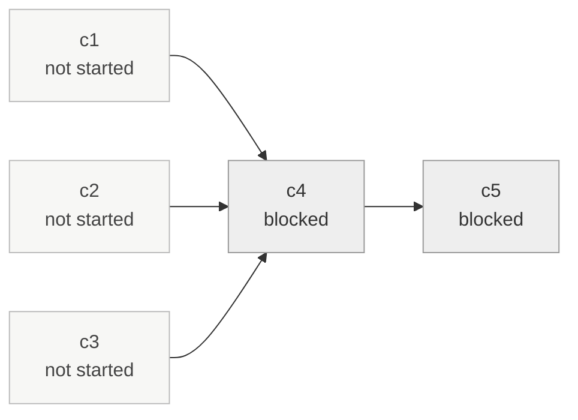

## @skunk-ape/rocky-road/breakdown-board

Model: rocky-road (@swamp/software-factory)  |  Scope: method  |  v8  |  2026-08-17T03:13:12.418Z

# Breakdown board — rr-publish-ready

**Stage:** breakdown-review · **Breakdown recorded:** 2026-08-17T02:34:55.889Z

**5 chunks** — 2 blocked · 3 not started

| | Chunk | State | Rounds | Depends on | Description |
| --- | --- | --- | --- | --- | --- |
| ` ` | c1 | not started | — | — | Add README.md for @skunk-ape/rocky-road with at least two fenced examples, and list it in additionalFiles. Fixes readme-example and rich-readme. |
| ` ` | c2 | not started | — | — | JSDoc the exported symbols in breakdown_board.ts so symbols-docs clears 80%. Comments only, no behaviour change. |
| ` ` | c3 | not started | — | — | Add breakdown_board_test.ts covering derived state (ready vs blocked vs not started), wave rendering from currentChunks and the legacy currentChunk, the stalled-chunk section, and silence on a factory with no breakdown artifact. Run with ~/.swamp/deno/deno test. |
| `.` | c4 | blocked | — | **c1**, **c2**, **c3** | Perform the adversarial review swamp extension push asks for and write the report to the path it names, obtained via push --dry-run --json. |
| `.` | c5 | blocked | — | **c4** | Verify: swamp extension quality reports 12/12 and push --dry-run is warning-free, then bump the manifest version. |

